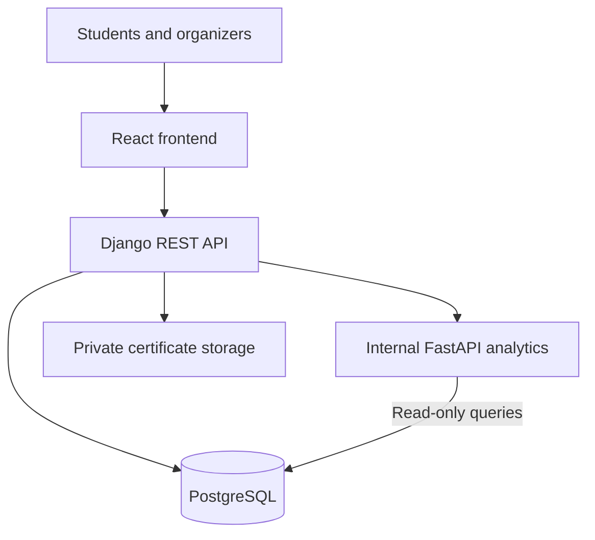

<div align="center">
  

  <h1>EventHub</h1>
  <p><strong>SHOW UP. STAND OUT.</strong></p>
  <p>A campus event platform for discovery, registrations, teams, QR attendance, analytics, and certificates.</p>

  
  
  
  
</div>

---

## 🔗 Project Links

- **Repository:** [EventHub](https://github.com/souvikkhaitan-hash/EventHub)
- **Frontend — local development:** http://localhost:5173
- **Django API — local development:** http://localhost:8000
- **Analytics health — local development:** http://127.0.0.1:8001/health

Deployment and Android installation support are planned. The addresses above are local development services.

## 📖 Overview

College events often rely on separate forms, spreadsheets, messages, and attendance lists. Students have to search for event details, while organizers maintain registrations, teams, and certificates in different places.

EventHub brings that workflow into one application. Students discover campus events, register individually or with a team, and receive a digital QR ticket. Organizers manage participation, record attendance, review event performance, and publish certificates to eligible students.

Built as a college full-stack project with **React + JavaScript, Django REST Framework, FastAPI, and PostgreSQL**.

## ✨ Key Features

### 🎓 Student Experience

- Register, sign in, and browse published upcoming events.
- Search and filter events by category.
- View schedules, venues, registration deadlines, and available places.
- Register for individual events or participate through teams.
- Create or join teams, manage invitations, and confirm eligible rosters.
- Access personal QR tickets and track registrations.
- Open published participation and achievement certificates.
- Share a public certificate verification link.

### 🛠️ Organizer Workspace

- Create event drafts, edit details, publish, and cancel events.
- Configure participant capacity, registration deadlines, and team limits.
- Search participants and filter registration records.
- Review forming, confirmed, and withdrawn teams.
- Expand team rosters to inspect member roles and attendance.
- Scan QR tickets or enter ticket tokens to record attendance.
- Review registrations, attendance rates, capacity utilization, categories, and registration growth.

### 🏅 Certificate Studio

- Upload private certificate backgrounds, signatures, and logos.
- Position dynamic text and reusable paragraphs on the artwork.
- Adjust fonts, text size, alignment, colour, and placement.
- Resize and rotate placed images.
- Save versioned layouts and inspect sample PDFs.
- Review participant eligibility and printed names.
- Record individual or team award results with a saved recipient roster.
- Generate private draft batches from saved layouts.
- Review PDFs and explicitly confirm publication.
- Publish final PDFs to the appropriate student accounts.
- Verify issued certificates publicly and revoke certificates with an audit record.

Participation eligibility checks include event completion, active registration, recorded attendance, and confirmed team membership where applicable. Award certificates additionally use an active recorded result and its saved recipients.

## 🧰 Tech Stack

| Layer | Technologies |
| --- | --- |
| Frontend | React, JavaScript, Vite, React Router |
| Interface | Custom CSS, responsive layouts, CSS animations, reduced-motion support |
| Main API | Python, Django, Django REST Framework |
| Analytics service | FastAPI, Uvicorn, Psycopg |
| Database | PostgreSQL |
| Authentication | Django sessions, role checks, CSRF protection |
| QR tickets | `qrcode.react`, `html5-qrcode` |
| Certificate generation | ReportLab, Pillow, bundled fonts |
| Backend tests | Django test framework |

## 🔄 Architecture



Django handles authentication, permissions, registrations, teams, attendance, and certificate operations. The frontend requests organizer analytics through Django; Django calls the internal FastAPI service using a shared service key. The analytics service reads PostgreSQL using a separate read-only account.

Private certificate files are retrieved through authorized API endpoints rather than public media URLs.

## 📁 Project Structure

| Path | Purpose |
| --- | --- |
| `frontend/src/components/` | Shared interface components, team registration, certificate workflows |
| `frontend/src/pages/` | Public, student, and organizer pages |
| `frontend/src/services/` | API requests |
| `frontend/src/styles/` | Shared and page-specific styles |
| `frontend/public/` | Public assets and category cover images |
| `backend/accounts/` | Authentication and user-related functionality |
| `backend/events/` | Events, registrations, teams, tickets, and attendance |
| `backend/certificates/` | Templates, assets, recipients, batches, results, and verification |
| `backend/config/` | Django configuration and root URL routing |
| `analytics_service/` | Internal FastAPI analytics application |

## ⚙️ Run Locally

### Prerequisites

- Python compatible with the pinned backend dependencies; development used Python 3.13.
- Node.js and npm compatible with `frontend/package.json`.
- PostgreSQL running locally.
- Git.

The commands below use **Windows PowerShell**. Start each service in a separate terminal.

### 1. Clone the repository

```powershell
git clone https://github.com/souvikkhaitan-hash/EventHub.git
cd EventHub
```

### 2. Create the local PostgreSQL database

Run in PostgreSQL's SQL Shell as an administrator. Replace the example passwords.

```sql
CREATE USER eventhub_user WITH PASSWORD 'replace_with_local_app_password' CREATEDB;
CREATE DATABASE eventhub_db OWNER eventhub_user;
```

`CREATEDB` allows Django to create its local test database. Deployment database permissions should be configured separately.

### 3. Configure Django

```powershell
cd backend
python -m venv .venv
.\.venv\Scripts\Activate.ps1
python -m pip install -r requirements.txt
```

Create `backend/.env`:

```dotenv
DB_NAME=eventhub_db
DB_USER=eventhub_user
DB_PASSWORD=replace_with_local_app_password
DB_HOST=localhost
DB_PORT=5432

ANALYTICS_SERVICE_URL=http://127.0.0.1:8001
ANALYTICS_INTERNAL_KEY=replace_with_a_long_random_shared_key
```

Apply migrations and create an administrator:

```powershell
python manage.py migrate
python manage.py createsuperuser
python manage.py check
python manage.py runserver
```

Django runs at **http://localhost:8000**.

### 4. Create the read-only analytics account

After applying Django migrations, run these commands in PostgreSQL's SQL Shell:

```sql
CREATE USER eventhub_analytics WITH PASSWORD 'replace_with_local_analytics_password';
GRANT CONNECT ON DATABASE eventhub_db TO eventhub_analytics;
```

Connect to the application database:

```text
\connect eventhub_db
```

Then grant the required read access:

```sql
GRANT USAGE ON SCHEMA public TO eventhub_analytics;
GRANT SELECT ON TABLE
    events_event,
    events_registration,
    events_eventticket
TO eventhub_analytics;
```

### 5. Configure and start analytics

In a second PowerShell terminal, from the repository root:

```powershell
cd analytics_service
python -m venv .venv
.\.venv\Scripts\Activate.ps1
python -m pip install -r requirements.txt
```

Create `analytics_service/.env`:

```dotenv
ANALYTICS_DB_NAME=eventhub_db
ANALYTICS_DB_USER=eventhub_analytics
ANALYTICS_DB_PASSWORD=replace_with_local_analytics_password
ANALYTICS_DB_HOST=localhost
ANALYTICS_DB_PORT=5432

ANALYTICS_INTERNAL_KEY=replace_with_a_long_random_shared_key
```

Use the **same `ANALYTICS_INTERNAL_KEY` value** in both environment files.

```powershell
python -m uvicorn main:app --host 127.0.0.1 --port 8001 --reload
```

Health endpoint: **http://127.0.0.1:8001/health**. This endpoint reports service availability; it is not a database-readiness check. Interactive API documentation is disabled in this internal service.

### 6. Start the frontend

In a third PowerShell terminal, from the repository root:

```powershell
cd frontend
npm install
npm run dev
```

Open **http://localhost:5173**. If Vite selects another port, update the allowed frontend origins in Django before using it.

The frontend defaults to Django at `http://localhost:8000`. To override it, create `frontend/.env`:

```dotenv
VITE_API_BASE_URL=http://localhost:8000
```

### 7. Enable an organizer account

1. Register an account through EventHub.
2. Sign in to Django admin at **http://localhost:8000/admin/** with the superuser account.
3. Create a group named exactly **`Organizer`** if it does not exist.
4. Add the intended organizer user to that group.
5. Sign out and sign back in to EventHub.

Regular registered accounts use the student experience. Organizer access is based on group membership.

## 🧪 Validation

From `backend/`, with its virtual environment active:

```powershell
python manage.py check
python manage.py makemigrations --check --dry-run
python manage.py test events accounts certificates --verbosity 1
```

For certificate tests only:

```powershell
python manage.py test certificates --verbosity 1
```

From `frontend/`:

```powershell
npm run build
```

The backend tests cover permissions, registration and team rules, attendance, certificate eligibility, draft generation, publication, verification, revocation, and award workflows. Run the commands against your current checkout rather than relying on a historical test count.

### Manual walkthrough

1. Create and publish a future event as an organizer.
2. Register as a student and open the QR ticket.
3. For a team event, create or join a team and confirm its roster.
4. Record attendance through the organizer scanner during the permitted check-in window.
5. Once the event has finished, review eligible certificate recipients.
6. Save a certificate layout, generate a draft batch, review its PDFs, and publish.
7. Confirm the certificate appears in the recipient's account and open its verification link.
8. Record an award result and repeat the achievement-certificate workflow.

## 🔐 Access and Data Handling

- Django session authentication and CSRF protection for authenticated writes.
- Organizer ownership checks on event management operations.
- Student access scoped to their registrations, tickets, and issued certificates.
- Server-side validation of capacity, team rules, attendance, and certificate eligibility.
- Internal-key protection for analytics requests.
- Private storage for certificate backgrounds, uploaded assets, and generated PDFs.
- Idempotent draft requests and constraints against duplicate active certificates.
- Public verification distinguishes issued and revoked certificates without exposing private PDFs or account credentials.

Environment files, virtual environments, dependency folders, and private certificate storage are excluded from Git. Never commit real passwords, service keys, or private documents.

## 📸 Screenshots

Screenshots can be added under `docs/screenshots/` and embedded here as the interface is finalized.

Suggested views: Home, Explore Events, Event Details, My Registrations, QR Ticket, Organizer Overview, Attendance, Analytics, Teams, and Certificate Studio.

<!-- Example after adding a screenshot:

-->

## 🎨 Interface and Assets

The interface uses a consistent cobalt, lime, charcoal, and warm ivory palette, with responsive layouts and reduced-motion support. Shared category covers appear across event listings, previews, and registration pages.

Category cover imagery is illustrative AI-generated artwork, not documentary photography of the listed events. Bundled font licenses are included alongside their font assets.

## 🚧 Next Steps

- Final responsive and end-to-end acceptance checks.
- Deployment configuration and public hosting.
- Installable PWA support for Android.

These are planned tasks, not claims of currently deployed functionality.

## 👤 Author

**Souvik Khaitan**  
[GitHub](https://github.com/souvikkhaitan-hash)

Built as a college full-stack project to connect event discovery, participation, attendance, and recognition in one workflow.

## 📄 License

A project-wide license has not been declared in this README. Add a `LICENSE` file before distributing the project under a specific open-source license. Third-party assets and dependencies retain their respective licenses.

---

<div align="center">
  <strong>EventHub — Show up. Stand out.</strong>
</div>
