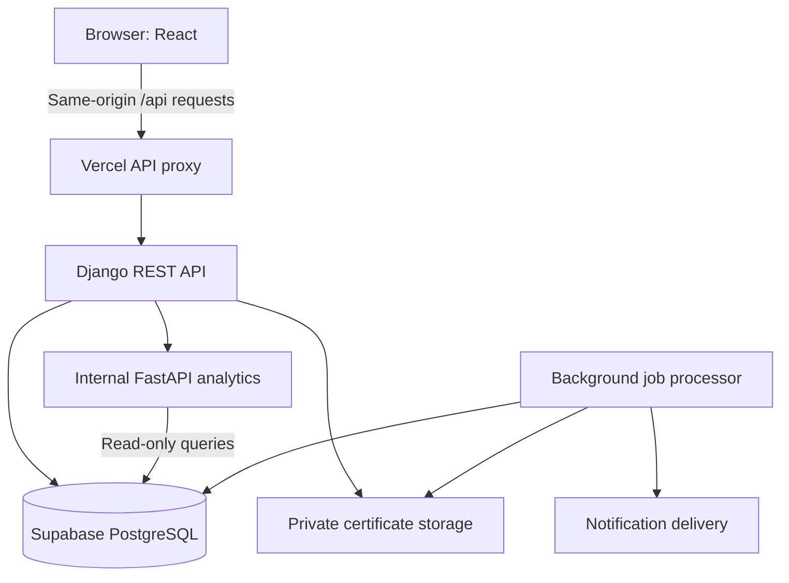

<div align="center">
  
  <h1>EventHub</h1>
  <p><strong>SHOW UP. STAND OUT.</strong></p>
  <p>College event discovery, registration, attendance and certificate management.</p>
  <p>
    <a href="https://event-hub-beryl-nu.vercel.app">Live Website</a>
    ·
    <a href="https://github.com/souvikkhaitan-hash/EventHub">Source Code</a>
  </p>
</div>

## Overview

College events often depend on separate forms, spreadsheets, messaging groups
and attendance lists. EventHub connects those activities in one application.

Students discover events, register individually or with a team, access QR
tickets and receive published certificates. Organisers manage events,
participants, staff access, attendance, announcements and certificate delivery.
Administrators review organiser applications.

The project uses React and JavaScript for the interface, Django REST Framework
for the main API, FastAPI for internal analytics and PostgreSQL for persistence.

## Live Deployment

| Component | Hosting |
| --- | --- |
| React frontend | Vercel |
| Django API | Render |
| Internal FastAPI analytics | Render |
| Background job processor | Render |
| PostgreSQL database | Supabase |
| Private certificate storage | Supabase Storage through its S3-compatible API |

**Website:** https://event-hub-beryl-nu.vercel.app

**Backend health endpoint:** https://eventhub-backend-u04u.onrender.com/api/info/

The current demonstration deployment runs Django, FastAPI and the background
job processor as supervised processes within one Render web service.

The free Render instance can sleep during inactivity. Initial requests may be
slow while it wakes, and background processing pauses while the instance is
asleep. An always-running deployment is required for continuous processing.

A successful deployment confirms that the services started. Hosted feature
acceptance is verified separately through the complete user workflow.

## Features

### Student Accounts and Participation

- Account registration, login and logout.
- Profile editing and password management.
- Password recovery through the configured email provider.
- Search and browse published events.
- View event dates, venues, capacity and registration deadlines.
- Register for individual events.
- Create or join teams for team events.
- Access personal registrations and QR tickets.
- Ask event questions and read official answers.
- Read public announcements.
- Access published certificates and public verification links.

### Organiser and Administrator Workspaces

- Organiser application submission and administrator review.
- Event drafts, editing, publication and cancellation.
- Registration deadlines, participant capacity and team limits.
- Participant search and team roster management.
- Event-specific staff access.
- QR scanning and manual attendance lookup.
- Attendance exports.
- Event analytics.
- Question moderation and official answers.
- Draft, publish, pin, edit and withdraw announcements.
- Event poster creation and sharing tools.

Event access is checked on the server. Owners, managers, attendance staff and
certificate staff receive the capabilities appropriate to their roles.
Attendance and certificate roles do not automatically gain event-editing or
communication-management permissions.

### Bulk Certificate Studio

Certificate generation and publication are separate operations.

1. Upload private backgrounds, signatures and logos.
2. Design a template with positioned text and images.
3. Save a template version.
4. Review eligible recipients and certificate names.
5. Start background PDF generation for the selected recipients.
6. Inspect progress, samples and completed draft PDFs.
7. Have the event owner review and publish the completed run.
8. Make the published certificates available to their recipients.

Additional capabilities include:

- Participation and award certificates.
- Individual and team award results.
- Versioned layouts and reusable template assets.
- Background generation with progress and retry handling.
- Private draft batches.
- Publication history.
- Public certificate verification.
- Certificate revocation with retained audit records.

Participation eligibility includes event completion, active registration,
recorded attendance and a valid certificate name. Team events also require the
appropriate confirmed team membership.

Award certificates use recorded results and their saved recipient rosters.
Award decisions remain with the event owner.

Certificate staff can prepare participation drafts. Publication remains an
explicit owner action.

**Bulk delivery means publishing each recipient's certificate to their account
and creating the corresponding notification. It does not mean emailing PDF
attachments to every participant.**

### Notifications

- Website notification bell and inbox.
- Read/unread controls and notification preferences.
- Optional browser push on supported, subscribed devices.
- Background processing of queued notification events.
- Registration, event update, reminder and certificate notifications.
- Staff, organiser application and event communication notifications.

Browser push requires production VAPID keys, browser permission, a saved device
subscription and a running background processor.

The website inbox remains available independently of external delivery
configuration. Actual device delivery must be tested separately from
configuration checks.

### Event Questions and Announcements

- Guests can read public content.
- Signed-in active accounts can ask event questions.
- Public questions use a generic participant label rather than exposing account
  names, email addresses or student IDs.
- Owners and authorised managers can answer and moderate.
- Students can edit their own unanswered visible questions or withdraw them.
- Organisers can hide or restore questions and retain private moderation reasons.
- Search, pagination and an unanswered filter.
- Revision checks, request-key retries and private mutation history.

Cancelled events remain readable, but new questions close.

Communication alerts use the website inbox and optional browser push.
They do not use email or WhatsApp.

### Promotion Tools

- Poster headline, invitation and host text.
- Preset styles and custom design controls.
- Optional image backgrounds.
- Reusable layout import and export.
- Live poster preview.
- Downloadable PNG exports.
- Portrait post and story formats.
- QR codes linking to the public event page.
- Copyable captions and event links.
- WhatsApp text/link sharing.
- Native image sharing where the device and browser support it.

The WhatsApp link action prepares a text message. It does not automatically
attach a poster. Use native image sharing where supported, or attach the
downloaded PNG manually.

Instagram-ready exports are downloadable images; the application does not
automatically publish to Instagram.

## Current Scope and Limitations

- Automated WhatsApp delivery is disabled pending Meta account verification and
  live provider testing.
- AI poster assistance is not part of the current implementation.
- Paid event registration is outside the current demonstration scope.
- Android store distribution is not part of the current deployment.
- Responsive layouts require manual acceptance across representative devices.
- Automated tests are not a substitute for hosted end-to-end verification or
  measured production load testing.

## Technology Stack

| Layer | Technologies |
| --- | --- |
| Frontend | React, JavaScript, Vite, React Router |
| Styling | Custom CSS and responsive layouts |
| Main backend | Python, Django, Django REST Framework |
| Analytics | FastAPI, Uvicorn, Psycopg |
| Database | PostgreSQL |
| Authentication | Django sessions and CSRF protection |
| QR tickets and scanning | qrcode.react, html5-qrcode |
| Certificate rendering | ReportLab and Pillow |
| Spreadsheet exports | openpyxl |
| Browser push | Service worker, Web Push and pywebpush |
| Private object storage | django-storages and S3-compatible storage |
| Deployment | GitHub, Vercel, Render and Supabase |
| Testing | Django test framework and Vite production build |

## Architecture



Django handles authentication, authorisation, event operations and business
rules. The frontend requests analytics through Django, which calls the internal
FastAPI service using a shared service key.

Analytics uses a separate database account with read-only access to the required
tables.

The background processor handles certificate generation, notification fan-out,
reminder scheduling and external notification delivery.

Private certificate assets and PDFs are accessed through authorised backend
operations rather than public object URLs.

## Project Structure

| Path | Responsibility |
| --- | --- |
| `backend/manage.py` | Django management command entry point |
| `backend/config/` | Settings, root URLs and server configuration |
| `backend/accounts/` | Accounts, profiles, passwords and organiser applications |
| `backend/events/` | Events, registrations, teams, tickets, staff and attendance |
| `backend/certificates/` | Templates, eligibility, generation, publication and verification |
| `backend/eventhub_notifications/` | Inbox, preferences, subscriptions and notification processing |
| `backend/event_communication/` | Questions, answers, announcements and moderation |
| `analytics_service/` | Internal FastAPI analytics application |
| `frontend/src/App.jsx` | Frontend routes and page loading |
| `frontend/src/components/` | Shared and feature-specific UI components |
| `frontend/src/pages/` | Public, student, organiser and administrator pages |
| `frontend/src/context/` | Shared React state, including authentication |
| `frontend/src/services/` | API request helpers |
| `frontend/src/styles/` | Shared and feature-specific CSS |
| `frontend/src/utils/` | Poster rendering and other utilities |
| `frontend/public/` | Public assets, manifest and notification service worker |
| `render-build.sh` | Production dependency installation and static collection |
| `render-start.py` | Migrations and supervised production processes |

There are **five custom Django apps**:

1. `accounts`
2. `events`
3. `certificates`
4. `eventhub_notifications`
5. `event_communication`

Django's built-in apps are additional. `config` is the Django project
configuration package. FastAPI analytics is a separate application, not a Django
app.

## Run Locally

The examples below use Windows PowerShell. Use separate terminals for each
running service.

### 1. Clone the repository

```powershell
git clone https://github.com/souvikkhaitan-hash/EventHub.git
cd EventHub
```

Use a checkout containing the completed feature integration.

### 2. Create a development database

Run in PostgreSQL as a database administrator:

```sql
CREATE USER eventhub_user
WITH PASSWORD 'replace_with_local_app_password' CREATEDB;

CREATE DATABASE eventhub_db OWNER eventhub_user;
```

`CREATEDB` allows the development account to create Django's test database.
Production database privileges should be configured separately.

### 3. Configure Django

```powershell
cd backend
python -m venv .venv
.\.venv\Scripts\Activate.ps1
python -m pip install -r requirements.txt
```

Create `backend/.env` with local values:

```dotenv
DJANGO_DEBUG=true
DJANGO_SECRET_KEY=replace_with_a_long_random_development_secret

FRONTEND_URL=http://localhost:5173
FRONTEND_ORIGINS=http://localhost:5173
DJANGO_CSRF_TRUSTED_ORIGINS=http://localhost:5173

DB_NAME=eventhub_db
DB_USER=eventhub_user
DB_PASSWORD=replace_with_local_app_password
DB_HOST=localhost
DB_PORT=5432
DB_SSLMODE=disable

ANALYTICS_SERVICE_URL=http://127.0.0.1:8001
ANALYTICS_INTERNAL_KEY=replace_with_a_long_random_shared_key

CERTIFICATE_STORAGE_BACKEND=local

WHATSAPP_ENABLED=false
WHATSAPP_MARKETING_ENABLED=false
```

Review `backend/config/settings.py` for additional provider-specific settings.
Keep production credentials separate from local development.

Apply migrations and create a local administrator:

```powershell
python manage.py migrate
python manage.py createsuperuser
python manage.py check
python manage.py runserver
```

Django runs at http://localhost:8000.

### 4. Configure analytics

Create a separate read-only PostgreSQL account:

```sql
CREATE USER eventhub_analytics
WITH PASSWORD 'replace_with_local_analytics_password';

GRANT CONNECT ON DATABASE eventhub_db TO eventhub_analytics;
```

Connect to `eventhub_db`, then grant the required access:

```sql
GRANT USAGE ON SCHEMA public TO eventhub_analytics;

GRANT SELECT ON TABLE
    events_event,
    events_registration,
    events_eventticket
TO eventhub_analytics;
```

In a second terminal, from the repository root:

```powershell
cd analytics_service
python -m venv .venv
.\.venv\Scripts\Activate.ps1
python -m pip install -r requirements.txt
```

Create `analytics_service/.env`:

```dotenv
ANALYTICS_DB_NAME=eventhub_db
ANALYTICS_DB_USER=eventhub_analytics
ANALYTICS_DB_PASSWORD=replace_with_local_analytics_password
ANALYTICS_DB_HOST=localhost
ANALYTICS_DB_PORT=5432
ANALYTICS_DB_SSLMODE=disable

ANALYTICS_INTERNAL_KEY=replace_with_a_long_random_shared_key
```

Use the same `ANALYTICS_INTERNAL_KEY` in Django and FastAPI.

Start analytics:

```powershell
python -m uvicorn main:app --host 127.0.0.1 --port 8001 --reload
```

Health endpoint: http://127.0.0.1:8001/health

This endpoint reports service availability, not complete database readiness.

### 5. Start the background processor

In a third terminal, from the repository root:

```powershell
cd backend
.\.venv\Scripts\Activate.ps1
python manage.py process_eventhub_jobs --watch
```

Keep this process running for background certificate generation and notification
processing.

### 6. Start React

In a fourth terminal, from the repository root:

```powershell
cd frontend
npm ci
npm run dev
```

Open http://localhost:5173.

The development frontend defaults to Django at http://localhost:8000.
If needed, configure `frontend/.env`:

```dotenv
VITE_API_BASE_URL=http://localhost:8000
```

If the frontend port changes, update Django's frontend origin settings.

### 7. Exercise organiser approval

1. Register a regular account.
2. Submit an organiser application through the website.
3. Sign in to the administrator workspace with an authorised reviewer account.
4. Review and approve the application.
5. Sign back in as the approved organiser and open the event workspace.

Use the approval workflow when demonstrating the application. Do not give
ordinary student accounts administrator privileges.

## Optional Browser Push Setup

From `backend/`:

```powershell
python manage.py notification_keys
```

Save the generated values in the backend environment:

```dotenv
VAPID_PUBLIC_KEY=generated_public_key
VAPID_PRIVATE_KEY=generated_private_key
VAPID_SUBJECT=mailto:your-contact-address@example.com
```

Generate the key pair once per environment and preserve it.

Restart the backend and background processor. Sign in, open notification
settings and enable notifications on a supported browser.

Check configuration:

```powershell
python manage.py check_notification_setup
```

Configuration readiness does not prove delivery. Trigger a real notification and
verify that it reaches the subscribed device.

## Production Configuration

Deployment settings:

| Platform | Branch | Configuration |
| --- | --- | --- |
| Vercel | `frontend` | Root `frontend`, build `npm run build`, output `dist` |
| Render | `backend` | Repository root, build `bash render-build.sh`, start `python render-start.py` |

The `main` branch is used for the integrated repository view.

Production configuration includes:

- `DJANGO_DEBUG=false`.
- A stable, private `DJANGO_SECRET_KEY`.
- The correct `FRONTEND_URL`, allowed hosts and trusted frontend origins.
- PostgreSQL credentials with SSL.
- Private S3-compatible certificate storage.
- Production VAPID credentials for browser push.
- Email provider credentials for email-dependent account features.
- Matching internal analytics keys and the analytics database account.

Private storage uses:

```text
CERTIFICATE_STORAGE_BACKEND=s3
S3_ENDPOINT_URL
S3_ACCESS_KEY_ID
S3_SECRET_ACCESS_KEY
S3_BUCKET_NAME
S3_REGION_NAME
```

Keep the certificate bucket private. Database backups and object-storage backups
must be handled separately.

Do not put database credentials, private VAPID keys, email keys or storage
secrets into frontend environment variables.

## Validation

From `backend/`, with its virtual environment active:

```powershell
python manage.py check
python manage.py makemigrations --check --dry-run
python manage.py test accounts events certificates eventhub_notifications event_communication --verbosity 1
```

From `frontend/`:

```powershell
npm run build
```

The recorded pre-deployment validation on 23 November 2026 completed with:

- 410 backend tests passing.
- No pending model changes detected.
- A successful frontend production build.

These results apply to the tested checkout. Rerun relevant checks after code
changes.

### Hosted Acceptance Workflow

1. Register accounts and approve an organiser application.
2. Create and publish a future event.
3. Register students and verify their individual QR tickets.
4. Exercise team creation and joining for a team event.
5. Ask a question, post an official answer and publish an announcement.
6. Generate and download an event poster.
7. Record attendance during the permitted window.
8. After the event ends, review certificate eligibility.
9. Generate multiple draft PDFs from one saved template version.
10. Review the run and publish as the owner.
11. Confirm each recipient can access their own certificate.
12. Verify website notifications and optional browser push.
13. Open public certificate verification while signed out.
14. Check private file persistence after a service restart.
15. Review analytics, exports and restricted staff access.

Use clearly labelled demonstration events. Do not bypass eligibility rules to
make the demonstration appear successful.

## Access and Data Handling

- Session authentication and CSRF protection.
- Server-side event ownership and staff capability checks.
- Student access scoped to their own private records.
- Server-side registration, team and attendance validation.
- Private certificate assets and generated PDFs.
- Explicit certificate publication and retained revocation history.
- Request-key retries and revision checks in applicable workflows.
- Public verification without public access to private PDF storage.
- Internal-key protection for analytics requests.
- Generic public question attribution and private moderation history.

Public questions and announcements should not contain private ticket, phone or
payment information.

Never commit `.env` files, passwords, provider credentials, private documents,
database exports or generated certificate files.

## Interface and Assets

The interface uses cobalt, lime, charcoal and warm ivory, with responsive
layouts and reduced-motion support.

Category cover imagery is illustrative AI-generated artwork, not documentary
photography of the listed events. Bundled fonts and third-party assets retain
their respective licences.

## Project Maintainer

**Souvik Khaitan**

GitHub: https://github.com/souvikkhaitan-hash

Developed as a college full-stack project connecting event discovery,
participation, attendance and recognition.

## Licence

No project-wide open-source licence is declared here. Third-party dependencies,
fonts and assets retain their respective licences.
